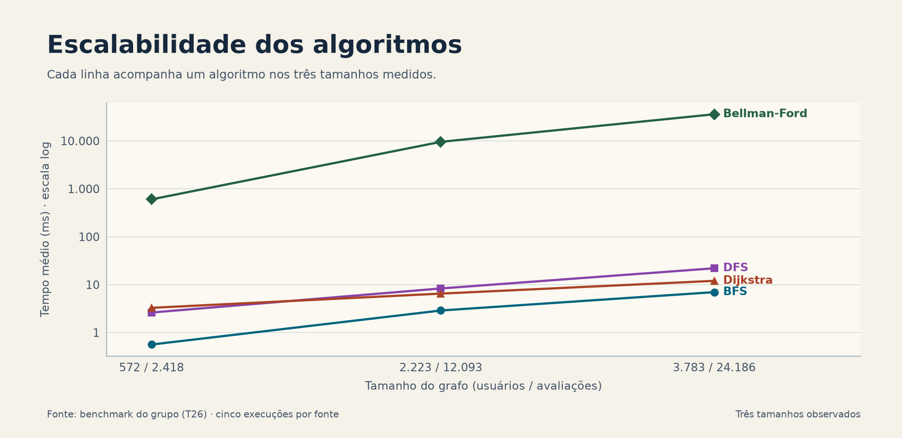
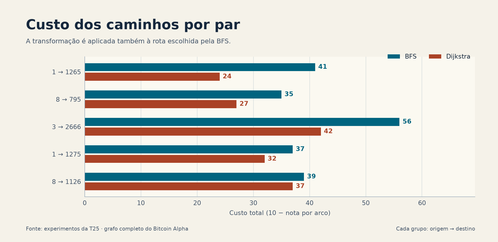
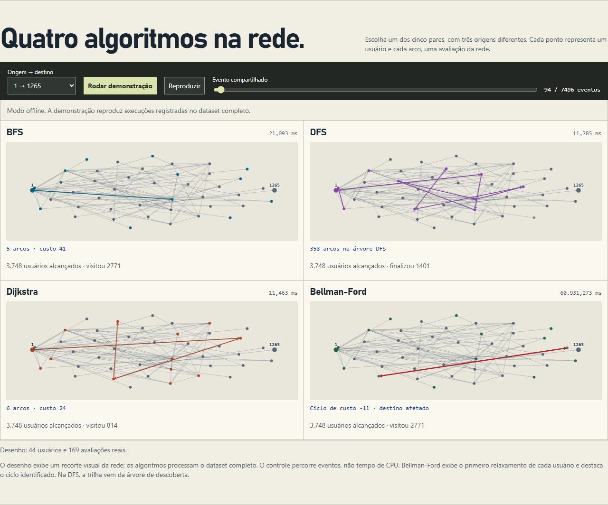

# Projeto de Grafos + AVD

**Relatório técnico para revisão do G1**

CESAR School · Turma 5B · 2026.2

Artur Antunes · Luca Albuquerque · Pedro Ferraz · Ricardo Machado · Victor Uen

**Versão de 24/11/2026.** Consolidação local baseada na `main` em `2ffc80d` e na bancada Bitcoin Alpha preparada na cópia de trabalho. A revisão dos integrantes e a declaração coletiva de IA são etapas do fechamento do grupo.

## Resumo

O projeto investiga duas aplicações de grafos dirigidos. Na Parte 1, construímos um grafo de estados para representar um labirinto com chaves, portas, terrenos e efeitos que dependem do percurso. Na Parte 2, representamos uma rede de **3.783 usuários e 24.186 avaliações** e comparamos quatro algoritmos. Testamos **cinco pares origem–destino em três origens**. Nos cinco casos, Dijkstra minimizou o custo transformado em comparação com a rota da BFS. A BFS minimizou a quantidade de arcos. A DFS revelou a estrutura da exploração. Bellman-Ford encontrou, com as notas originais, um ciclo negativo que tornou indefinido o custo mínimo aos destinos selecionados.

## 1. Construção e organização do projeto

1. **Definir a estrutura.** O código usa listas de adjacência em `src/graphs/graph.py`. A direção, o peso e os metadados ficam associados ao arco. A ordem de inserção é preservada para tornar as buscas reproduzíveis.
2. **Construir o grafo antes de resolver o problema.** O leitor transforma mapas em grades e avaliações em registros tipados. As regras da Parte 1 geram estados alcançáveis. Na Parte 2, os usuários e as avaliações já fornecem os vértices e arcos.
3. **Separar cálculo e apresentação.** Os algoritmos ficam em `src/graphs/algorithms.py`. A CLI, os módulos de análise e as visualizações consomem os resultados e exportam CSV, JSON, PNG e HTML.
4. **Validar a integração.** A suíte verifica estruturas, estados, casos sintéticos, os mapas do projeto, os experimentos e as saídas. O NetworkX é usado como oráculo em testes. As execuções foram conferidas com **585 testes aprovados**.

### 1.1 Contribuições e evidências

| Integrante | Responsabilidade e evidências |
|---|---|
| Pedro Ferraz | P5, visualização e comunicação. Estrutura inicial (`f6ecdd2`), modelo e README (`c86c298`), interface inicial (`1dc69ee`), rascunho dos mapas (`a5554da`), figuras de percurso e árvore BFS (`9b01e6b`). Coordena a consolidação da T37. |
| Ricardo Machado | P1, leitura, modelagem, `Graph`, CLI e integração da Parte 1. `d101546`, `d9925b7`, `25358b2`, `f03c80c`, `1a5f538`. |
| Luca Albuquerque | P3, testes com oráculo, métricas, camadas, comparação de modelagens e figuras do grafo de estados. `a40c945`, `5a9c598`, `d285bd2`, `a222b0c`, `ff83d6b`. |
| Victor Uen | P4, dataset, preparação, benchmark e visualizações AVD. `9a220b0`, `1e7d8b4`, `f2fce8a`, `643af90`, `7c03af3`, `bae6f20`. |
| Artur Antunes | P2, casos de teste, publicação dos algoritmos e testes iniciais gerados com OpenAI Codex, experimentos T25, apoio à T32, revisão T34 e seção T36. Redesenho do interativo e bancada Bitcoin Alpha. `9c109bf`, `d9310ad`, `da60e62`, `ab7eddf`, `527d9e6`, `2ffc80d`. |

A marcação no código registra a geração inicial de algoritmos e testes com IA, seguida dos ajustes do grupo. Esta consolidação recebeu assistência de IA na redação e na organização das evidências. Cada integrante registra o próprio uso no documento coletivo.

<!-- pagebreak -->

## 2. Parte 1 · Labirintos

### 2.1 Da grade ao grafo de estados

O leitor valida a grade e identifica início, saída e símbolos. Em seguida, partimos de `S` e exploramos movimentos em ordem norte, leste, sul e oeste. O vértice precisa guardar posição, chaves coletadas e bônus consumidos. Duas visitas à mesma casa podem representar estados diferentes se, por exemplo, uma delas já tiver a chave de uma porta. Um movimento é um arco dirigido porque chaves, portas, esteiras e consumo podem tornar a ida e a volta diferentes. Cada estado de chegada em `G` liga-se ao vértice virtual `ALVO` por um arco de custo zero. A exportação exclui esse arco da contagem dos passos físicos.

### 2.2 Testar se a representação preserva as regras

Comparamos o grafo de posições com portas tratadas como chão, com portas tratadas como paredes e o grafo de estados. A primeira opção admite atalhos inválidos. A segunda elimina passagens que deveriam ser liberadas após coletar uma chave. A terceira representa as condições de acesso.

| Mapa | Posições, porta como chão | Posições, porta como parede | Grafo de estados, BFS |
|---|---:|---|---:|
| m02 | 10 passos, inválido | Sem solução | 34 passos, válido |
| m03 | 21 passos, inválido | Sem solução | 87 passos, válido |
| m04 | 14 passos, inválido | Sem solução | 20 passos, válido |

No m01, a BFS chega em **10 passos, custo 30**, enquanto Dijkstra e Bellman-Ford chegam em **14 passos, custo 20**. No m03, o mesmo contraste aparece entre **87 passos, custo 119** e **91 passos, custo 99**. A diferença vem do custo dos terrenos e da rota escolhida.

### 2.3 Pesos negativos, armadilhas e DFS

- **m05.** O grafo de posições permite repetir o bônus de −4 e contém ciclo de custo −3. No grafo de estados, consumir o bônus altera o estado. A execução de Bellman-Ford encontrou custo mínimo 5 em 20 passos. Dijkstra recusou os pesos negativos.
- **m06.** O ciclo original soma −1: entrar na fonte custa −2 e voltar custa 1. Cada repetição pode reduzir o custo até `ALVO`. Com `--fonte-consumivel`, a fonte só tem custo −2 na primeira entrada e passa a custar 1. A reprodução encontrou **custo 10 em 10 passos**.
- **m07.** Nenhum dos 16 estados físicos alcançáveis chega a `ALVO`. Todos são armadilhas. O algoritmo distingue estados-armadilha procurando o conjunto alcançável a partir de `S` e subtraindo os que alcançam o alvo no grafo transposto.
- **DFS.** A busca classifica arcos em árvore, retorno, avanço e cruzamento. No m06 são 23, 22, 0 e 1. No m07 são 15, 19, 4 e 0, respectivamente. A classificação exclui os arcos com destino `ALVO`. Um arco de retorno aponta um ciclo dirigido. A detecção de **custo** negativo exige os pesos.

O mapa do grupo **m1** tem chaves, portas, esteiras e bônus. A BFS percorre 46 passos, com custo 49, e Bellman-Ford encontra custo mínimo 42 em 52 passos. O **m2** tem 6 estados-armadilha em 13 estados alcançáveis, ou **46,15%**. As visualizações mostram percurso, árvore da BFS, camadas e multiplicidade de estados por posição. O interativo exibe a posição, as chaves e os custos no decorrer da busca. [Resultados da Parte 1](../out/parte1/) · [Modelagem](relatorio_modelagem.md) · [Algoritmos](relatorio_algoritmos.md)

Na demonstração ao vivo, é possível enviar um mapa `.txt` pelo painel Labirinto do servidor local. O arquivo passa pelo leitor e pelo construtor usados na CLI. As saídas alimentam a Mesa de rotas e a vista sincronizada dos quatro algoritmos. Assim, um mapa recebido na hora pode ser testado no mesmo fluxo dos mapas do projeto.

<!-- pagebreak -->

## 3. Parte 2 · Bitcoin Alpha

### 3.1 Pergunta, origem dos dados e preparação

A pergunta do projeto é como padrões de confiança e desconfiança se relacionam com caminhos entre usuários e com ciclos de avaliações negativas. A fonte é o **Stanford Network Analysis Project (SNAP)**. Cada registro contém identificador do avaliador, identificador do avaliado, nota e momento da avaliação em segundos desde a época Unix. As notas vão de −10 a +10. A página do dataset fornece o arquivo e as referências para citação. Nela não consta uma licença específica. [Dataset Bitcoin Alpha, SNAP](https://snap.stanford.edu/data/soc-sign-bitcoin-alpha.html)

1. **Validar os registros.** O arquivo tem 24.186 linhas e quatro campos. Não foram encontradas células nulas ou linhas inteiramente duplicadas. Há 22.650 notas positivas e 1.536 negativas. A nota +1 aparece 13.760 vezes. A ausência de uma avaliação entre dois usuários significa ausência de arco observado. Esse par fica sem nota atribuída no grafo.
2. **Preservar direção e sinal.** Cada usuário vira um vértice. Se A avaliou B, o arco é A → B. O arco inverso depende de uma avaliação própria. As notas originais são necessárias para o estudo dos ciclos negativos.
3. **Gerar os recortes.** Ordenamos por timestamp, de forma estável, e usamos as primeiras avaliações em cada percentual. Cada recorte contém os usuários presentes nas avaliações selecionadas. A sequência é temporal e determinística, portanto a composição da rede muda com o recorte.

| Recorte | Usuários | Avaliações | Fontes do benchmark |
|---|---:|---:|---|
| 10% | 572 | 2.418 | 2, 4, 129 |
| 50% | 2.223 | 12.093 | 1, 2, 4 |
| 100% | 3.783 | 24.186 | 1, 3, 8 |

### 3.2 O que é um menor caminho?

No Bitcoin Alpha, um caminho dirigido de A até D pode ser A → B → C → D. Isso quer dizer que cada usuário avaliou o próximo, na direção indicada. Um algoritmo escolhe **qual quantidade minimizar**.

| Pergunta | Algoritmo | Interpretação |
|---|---|---|
| Qual cadeia usa menos avaliações? | BFS | Cada arco conta como um passo. A busca em níveis garante o menor número de arcos em um grafo sem pesos para esse objetivo. |
| Qual cadeia tem menor custo pela regra do projeto? | Dijkstra | Para cada avaliação, o custo é **10 − nota**. Uma nota +10 custa 0, uma +1 custa 9 e uma −10 custa 20. Todos os custos ficam não negativos. |
| Como os usuários alcançáveis se organizam durante uma exploração? | DFS | A busca aprofunda um ramo e registra descoberta, finalização e classes de arcos. A trilha da árvore da DFS depende da ordem de exploração. |
| O que acontece com as notas assinadas originais? | Bellman-Ford | Soma as notas originais, aceita arcos negativos e identifica quando um ciclo negativo impede um mínimo finito até um destino. Esse modelo serve para estudar o sinal das notas. |

Para uma cadeia de `k` avaliações, o custo de Dijkstra é **10 × k − soma das notas**. A regra favorece notas altas por arco e introduz uma penalidade pela quantidade de arcos. Por isso, um caminho um pouco mais longo pode custar menos. A escolha mede um critério do experimento. As avaliações observadas não dão uma garantia de confiança transitiva nem de segurança nas transações.

<!-- pagebreak -->

### 3.3 Quatro algoritmos, três fontes e cinco pares

1. **Escolher as fontes.** No grafo completo, usamos os usuários 1, 8 e 3, com maior grau de saída. O desempate é por menor identificador.
2. **Escolher os destinos.** Ordenamos os usuários alcançáveis por distância da BFS decrescente, depois pelo identificador. Selecionamos pares alternando as fontes. Assim, testamos cadeias mais longas em termos de número de arcos dentro de cada conjunto alcançável. Como a escolha é determinística e favorece fontes com muita atividade, os pares representam estudos de caso.
3. **Executar os quatro e comparar.** A BFS e a DFS usam o grafo original, sem ler os pesos para decidir a exploração. Dijkstra usa o grafo transformado. Para comparar justamente os dois caminhos, calculamos o custo da rota da BFS também com `10 − nota`. Bellman-Ford usa as notas originais.

| Origem → destino | BFS: arcos / custo | DFS: arcos na árvore | Dijkstra: arcos / custo | Bellman-Ford original |
|---|---:|---:|---:|---|
| 1 → 1265 | 5 / 41 | 358 | 6 / 24 | Destino afetado pelo ciclo negativo |
| 8 → 795 | 5 / 35 | 150 | 5 / 27 | Destino afetado pelo ciclo negativo |
| 3 → 2666 | 6 / 56 | 467 | 8 / 42 | Destino afetado pelo ciclo negativo |
| 1 → 1275 | 5 / 37 | 407 | 9 / 32 | Destino afetado pelo ciclo negativo |
| 8 → 1126 | 5 / 39 | 339 | 7 / 37 | Destino afetado pelo ciclo negativo |

**Exemplo 1 → 1265.** A BFS escolheu `1 → 2 → 915 → 239 → 448 → 1265`. São cinco arcos, soma das notas 9 e custo 41. Dijkstra escolheu `1 → 160 → 89 → 28 → 1007 → 448 → 1265`. São seis arcos, soma das notas 36 e custo 24. A rota de Dijkstra tem um arco a mais e custo 17 menor. No caso 8 → 795, os dois percursos têm cinco arcos, mas Dijkstra reduz o custo de 35 para 27.

| Fonte | Usuários alcançados por BFS/DFS, incluindo a fonte | Maior nível BFS | DFS: árvore / retorno / avanço / cruzamento |
|---|---:|---:|---:|
| 1 | 3.748 | 5 | 3.747 / 11.426 / 8.572 / 395 |
| 8 | 3.748 | 5 | 3.747 / 11.398 / 8.617 / 378 |
| 3 | 3.748 | 6 | 3.747 / 11.409 / 8.647 / 337 |

**Dois casos de Bellman-Ford.** No grafo original apareceu o ciclo `498 → 708 → 498`, com notas −1 e −10 e soma **−11**. Nos cinco pares, o ciclo é alcançável a partir da origem e seu efeito alcança o destino. Repeti-lo reduz a soma em 11 por volta, então não existe menor custo finito para os percursos que permitem repetição. Para testar pesos negativos com mínimo finito, montamos um subgrafo que conserva somente arcos que avançam nos níveis da BFS a partir da fonte 2. Um ciclo exigiria voltar a um nível anterior, por isso esse subgrafo é acíclico. O caminho `2 → 7508` tem custo **−5**. Esse caso foi obtido em outra modelagem e não altera os resultados do grafo original.

<!-- pagebreak -->

### 3.4 Desempenho e cenários de uso

O benchmark do Victor mediu **cinco execuções por algoritmo, recorte e fonte**, com três fontes em cada recorte. São 36 grupos e 180 medições. O cronômetro envolve o algoritmo. A leitura do CSV e a preparação do grafo transformado de Dijkstra acontecem antes. Como o benchmark não registra a configuração da máquina, os tempos caracterizam essas medições. Os tempos únicos da bancada ao vivo ficam separados.

| Algoritmo | Média 10% (ms) | Média 50% (ms) | Média 100% (ms) | Mediana 100% (ms) | Desvio amostral 100% (ms) | Mín. / máx. 100% (ms) |
|---|---:|---:|---:|---:|---:|---:|
| BFS | 0,564 | 2,892 | 6,989 | 6,093 | 2,386 | 4,297 / 11,957 |
| DFS | 2,624 | 8,342 | 21,998 | 16,162 | 15,316 | 12,373 / 68,647 |
| Dijkstra | 3,288 | 6,514 | 12,019 | 11,587 | 1,365 | 10,102 / 14,937 |
| Bellman-Ford | 603,092 | 9.562,039 | 36.002,958 | 34.353,114 | 3.917,639 | 33.016,080 / 47.756,226 |

Cada célula de média por recorte agrega **15 tempos** de três fontes. O desvio amostral e os extremos na tabela se referem às 15 medições do recorte completo. O painel permite inspecionar as cinco repetições e as estatísticas de cada fonte separadamente. Como as fontes mudam entre recortes, a diferença dos tempos inclui efeitos da topologia e da origem. Três recortes por si só não comprovam uma ordem de crescimento assintótica. [Medições](../out/parte2/benchmark.csv) · [Tabelas por fonte](../out/parte2/dados_comparacao_algoritmos/)

- **BFS teve a menor média nos três recortes.** É a escolha adequada para minimizar arcos. Com remoção constante na fila, a busca usual custa O(V + E). A versão medida usa `list.pop(0)`, que desloca os itens e pode aumentar o custo de fila.
- **DFS é adequada para estrutura e alcance.** A implementação percorre as listas de adjacência em O(V + E). A média medida também inclui a classificação de arcos e os registros de descoberta e finalização.
- **Dijkstra escolhe o mínimo ponderado no grafo transformado.** A checagem de pesos custa O(E). O heap pode receber entradas repetidas de um mesmo vértice. Seu resultado resolve um objetivo diferente da BFS mesmo quando os tempos são próximos.
- **Bellman-Ford lida com pesos negativos.** O pior caso é O(VE). Relaxar repetidamente os arcos torna a execução mais cara. Na rede original com ciclo alcançável, a média medida foi de cerca de **36 s** no grafo completo. Neste caso, seu resultado mais importante é identificar a ausência de um mínimo finito.

*V* é o número de vértices e *E* o número de arcos. O melhor algoritmo depende da pergunta, dos pesos e da garantia desejada. Pelos cinco pares verificados, Dijkstra é a escolha para custo transformado, BFS para mínimo de arcos, DFS para estrutura e Bellman-Ford para notas assinadas e ciclos. Esses objetivos dão a cada algoritmo um papel na análise.

**Figura 1.** Escalabilidade dos algoritmos nos recortes. O tempo usa escala logarítmica para acomodar as diferentes ordens de grandeza.

<!-- pagebreak -->

### 3.5 O que as visualizações mostram

As figuras usam cores e marcadores consistentes para cada algoritmo, rótulos próximos dos valores e agrupamento visual das duas rotas de cada par. O fundo e as grades têm baixo contraste para que os dados se destaquem. A aba **Gráficos** permite consultar as 12 figuras individualmente.

Os seis gráficos exploratórios do Victor examinam notas, atividade por usuário, concentração de negativas e variação temporal. As duas figuras explanatórias comparam a proporção de notas negativas ao longo dos anos e o grau de entrada de usuários avaliados conforme receberam ou não uma nota negativa. Entre os avaliados, a média de avaliações recebidas foi maior no grupo com pelo menos uma negativa. Usuários que recebem muitas avaliações também têm mais oportunidades de receber avaliações negativas. Essa associação não estabelece causa.

| Visualização | Pergunta que ajuda a responder | Evidência |
|---|---|---|
| Distribuição, avaliações por usuário, evolução por ano, recebidas × negativas, evolução mensal e boxplot | Como as notas e a atividade se distribuem? | [Seis PNGs](../out/parte2/avd/) · [Notas exploratórias](avd/visualizacoes.md) |
| Proporções por ano e conectividade de entrada | Como a desconfiança registrada varia no tempo e se associa ao volume recebido? | [Duas figuras](../out/parte2/avd/visualizacoes_explanatorias/) · [Notas explanatórias](avd/visualizacoes_explanatorias.md) |
| Custos e quantidade de arcos nos cinco pares | Quais caminhos mudam ao passar de contagem de arcos para custo transformado? | [Quatro comparativos](../out/parte2/avd/comparacao_algoritmos/) · [Dados dos caminhos](../out/parte2/dados_comparacao_algoritmos/comparacao_caminhos.csv) |
| Quatro grafos sincronizados e caso com ciclo negativo | Como as estratégias exploram a mesma rede e por que um destino pode ficar sem custo mínimo? | [Bancada Bitcoin Alpha](../out/parte1/bitcoin_alpha.html) · [Relatório JSON](../out/parte2/parte2_report.json) |

**Figura 2.** Comparação de custo pela regra `10 − nota`. A regra é aplicada também aos caminhos escolhidos pela BFS.

### 3.6 Como foi construída a demonstração

1. Executamos o leitor e os algoritmos existentes nos cinco pares e três origens. Registramos descobertas na BFS, descobertas e finalizações na DFS, expansões no Dijkstra e o primeiro relaxamento de cada usuário no Bellman-Ford.
2. A página tem duas vistas. A rede completa mostra os 3.783 usuários e as 24.186 avaliações, com zoom, localização por ID e destaque da exploração. Nos quatro painéis, uma amostra inclui origem, destinos, trechos dos caminhos e, quando presente, os vértices do ciclo negativo. O desenho mantém as avaliações reais entre os usuários selecionados.
3. Os quatro painéis usam a mesma posição dos usuários e o mesmo controle de reprodução para facilitar a comparação. Todos os algoritmos calculam sobre o grafo completo. O controle percorre eventos registrados e não representa tempo de CPU.
4. Exportamos um HTML offline para repetir os resultados. As abas dão acesso ao grafo, aos tempos, aos caminhos, aos casos de busca e ao método. No modo local, o painel solicita novas execuções ao servidor Python do notebook. O servidor entrega cada resultado assim que termina. O cronômetro do teste ao vivo é separado das medições prévias.

<!-- pagebreak -->

## 4. Conclusões e reprodução

A primeira parte mostrou por que o estado precisa guardar a história relevante do percurso. No grafo de estados, chegar à mesma posição com chaves diferentes muda as opções disponíveis. Consumir um bônus ou uma fonte também pode mudar a existência de ciclos negativos. Distância em passos e custo são critérios diferentes, como m01 e m03 demonstram.

Na segunda parte, a diferença entre os objetivos apareceu nos próprios pares. **Dijkstra reduziu o custo transformado em todos os cinco casos. A BFS encontrou o menor número de arcos.** As trilhas da DFS são evidência de alcance e da ordem de exploração. Os ciclos de retorno que ela identifica independem dos pesos. Com as notas originais, Bellman-Ford detectou um ciclo negativo que atingiu os destinos dos cinco pares. Esse é o resultado mais direto sobre ciclos e custo assinado no dataset. Os gráficos temporais e de conectividade dão contexto sobre os registros de confiança. Eles não isolam um efeito causal das avaliações negativas na formação das cadeias.

### 4.1 Passos para reproduzir

Na raiz do repositório, com Python 3.11 ou superior e as dependências de `requirements.txt` no ambiente virtual:

~~~powershell
python -m pytest -q
$repro = Join-Path ([System.IO.Path]::GetTempPath()) ("grafos-avd-" + [guid]::NewGuid())
$parte1 = Join-Path $repro "parte1"
$parte2 = Join-Path $repro "parte2"
python -m src.cli --interactive --fonte-consumivel --out $parte1
python -m src.analises --out $parte1
python -m src.parte2 --out (Join-Path $parte2 "parte2_report.json")
python -m src.avd.comparacao_algoritmos --relatorio (Join-Path $parte2 "parte2_report.json") --benchmark out/parte2/benchmark.csv --out (Join-Path $parte2 "dados_comparacao_algoritmos")
python -m src.avd.servidor_bitcoin
~~~

Com o último comando ativo, abra o painel em `http://127.0.0.1:8765/bitcoin_alpha.html` e selecione um par em **Quatro algoritmos na rede**. Para refazer as medições, use a CLI com `--benchmark --dataset data/dataset_parte2/soc-sign-bitcoinalpha.csv --out $parte2`. Para regenerar a reprodução offline, use `python -m src.avd.experimentos` e depois `--interactive`. As execuções do Bellman-Ford no grafo completo podem levar vários segundos por fonte. Os comandos temporários preservam os resultados publicados.

### 4.2 Referências e materiais do grupo

- Stanford Network Analysis Project. [Bitcoin Alpha trust weighted signed network](https://snap.stanford.edu/data/soc-sign-bitcoin-alpha.html).
- Kumar, S. et al. *Edge Weight Prediction in Weighted Signed Networks*. IEEE ICDM, 2016. Kumar, S. et al. *REV2: Fraudulent User Prediction in Rating Platforms*. ACM WSDM, 2018. Referências indicadas na página do dataset.
- [Planejamento do G1](PLANEJAMENTO_2026-11-09.pdf) · [Contratos de saída](contratos.md) · [Modelo do relatório](RELATORIO_TECNICO_MODELO.md).
- [Revisão de integração T34](revisao_integracao_t34.md) · [Roteiro de ensaio](ensaio_artur.md) · [Apoio às tabelas T32](avd/apoio_comparacao.md).

<!-- pagebreak -->

## Apêndice · Demonstração do Bitcoin Alpha

**Figura 3.** Captura das execuções registradas para `1 → 1265`. O desenho contém 44 usuários e 169 avaliações reais selecionadas. As contagens de alcance e os resultados foram calculados no grafo completo. Os tempos exibidos vêm da execução instrumentada que produziu os eventos da animação. A tabela da seção 3.4 usa o benchmark publicado.
